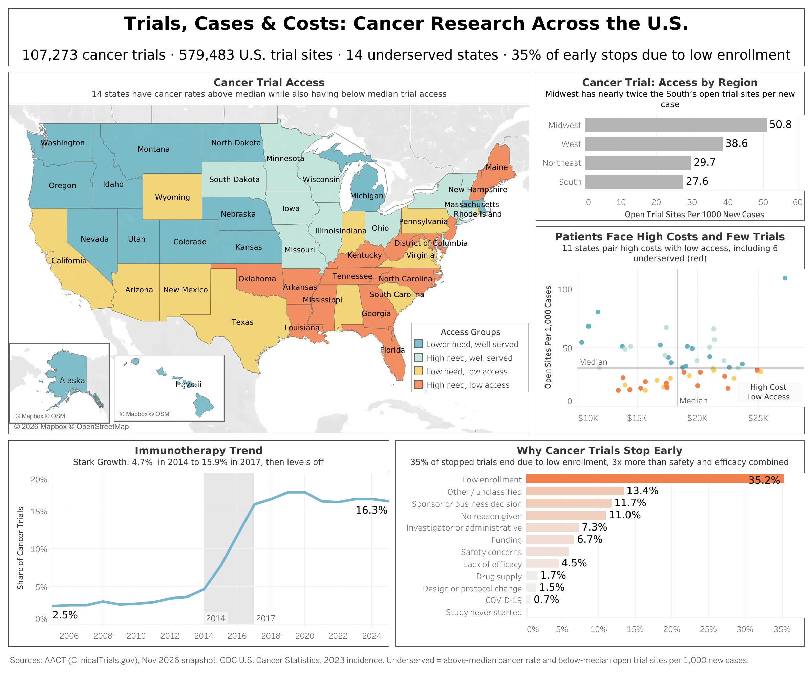

# Trials, Cases & Costs: Mapping Cancer Research Across the U.S.

**Where can cancer patients actually join a clinical trial, and who gets left out?**

This SQL project analyzes 107,273 cancer clinical trials from ClinicalTrials.gov, combined with CDC cancer incidence and Medicare chemotherapy costs, to map trial access across all 50 states and DC.

**[View the interactive dashboard on Tableau Public](https://public.tableau.com/app/profile/jessica.kiesel/viz/CancerTrialsCasesandCosts/CancerTrials)**



---

## Key Findings

1. **14 states are underserved**, with above-median cancer rates and below-median trial access. **11 of them are in the South.** Midwest patients have nearly twice as many open trial sites per new cancer case as Southern patients (50.8 vs. 27.6 per 1,000 cases).
2. **Access varies about 5x between states.** Mississippi and Alabama have ~14 open trial sites per 1,000 new cancer cases; Wisconsin and Minnesota have ~66–67.
3. **Low enrollment is the #1 reason trials stop early:** 35% of 14,287 stopped trials, more than three times safety and efficacy concerns combined (10.4%). Stopped trials ran a median of 2.8 years before ending.
4. **Immunotherapy reshaped cancer research.** Its share of new cancer trials rose from 4.7% to 15.9% between 2014 and 2017, following the first PD-1 drug approvals, then leveled off at ~16–17%.
5. **Some patients face a double burden.** Six underserved states (Georgia, Maryland, New Hampshire, New Jersey, North Carolina, Tennessee) also have above-median Medicare costs per inpatient chemotherapy stay. Across all states, costs ($10.4K–$27.2K) are not linked to trial access.
6. **Academic centers lead 71% of cancer trials**, and the U.S. National Cancer Institute is the top sponsor (3,055 trials). Industry leads 21%, but its trials are 2.5x more likely to be late-stage.

## All 12 Questions

| # | Question | Answer in brief |
|---|---|---|
| 1 | How many cancer trials are there by phase and status? | Phase 2 is most common (27,014); ~20% of early-phase trials stop early vs. ~12% of Phase 3–4 |
| 2 | Which cancer types have the most trials? | Breast (13.6%) and lung (11.0%); prostate, the 2nd most diagnosed cancer, ranks only 7th |
| 3 | How do industry and academic sponsors compare? | Academic centers lead 70.8% of trials; industry 21.2%; industry is involved in 31.8% overall |
| 4 | Which blood cancer trials report the highest complete remission rates? | 318 trials report rates; median 22% (Phase 1) to 36% (Phase 2); academic-led trials report higher rates, likely reflecting patient mix |
| 5 | Why do trials stop early? | Low enrollment (35.2%) leads all reasons |
| 6 | How has immunotherapy grown? | Share rose from 4.7% to 15.9% in 2014–2017, then plateaued |
| 7 | Who are the top 10 sponsors? | NCI, MD Anderson, Memorial Sloan Kettering, Sun Yat-sen, Fudan; the top 10 lead only ~12% of trials |
| 8 | How long do trials last? | Median 3.7 years (Phase 1) to 5.3 years (Phase 3) |
| 9 | How many trial sites does each state have? | California leads in total; per resident, the bottom six states are all Southern |
| 10 | Which states have the fewest sites per cancer case? | Mississippi, Alabama, Oklahoma, West Virginia, New Hampshire |
| 11 | Do chemo costs relate to trial access? | No meaningful relationship (correlation ≈ 0) |
| 12 | Which states look underserved overall? | 14 states; 11 in the South |

## Data Sources

| Source | Description | Version |
|---|---|---|
| [AACT](https://aact.ctti-clinicaltrials.org/) | ClinicalTrials.gov registry as a PostgreSQL database | Snapshot of Nov 1, 2026 |
| [CDC U.S. Cancer Statistics](https://www.cdc.gov/cancer/dataviz/) | New cancer cases and age-adjusted rates by state | 2023 incidence (1999–2023 data file) |
| [CMS Medicare Inpatient Hospitals by Geography and Service](https://data.cms.gov/) | Average payments per hospital stay; DRGs 846–848 (chemotherapy) | 2024 |

## Methods

- **Cancer trials** were identified using standardized MeSH condition terms (e.g., "breast neoplasms," "leukemia"), excluding non-cancer terms found during review ("tumor virus infections," "pseudotumor").
- **Immunotherapy trials** were identified three ways, since no column labels them: MeSH intervention categories, official drug-naming conventions (e.g., *-lizumab*, *-leucel*), and treatment descriptions. A missed-trial check estimated ~92% coverage.
- **Reasons trials stopped** were sorted from free text into categories with keyword matching, refined using random samples of unclassified reasons. 84.9% of given reasons were classified.
- **State access** compares U.S. trial sites against population (sites per million residents) and new cancer cases (open sites per 1,000 new cases).
- **"Underserved"** means a state has both an above-median age-adjusted cancer rate and below-median open trial sites per 1,000 new cases.
- **Validation:** every key number in this README was recomputed from the database (`sql/analysis/final_checks.sql`).

**SQL skills used:** joins, CTEs, views, CASE, window functions (`RANK`, `LAG`, `NTILE`, `PARTITION BY`), aggregate `FILTER`, `PERCENTILE_CONT` (medians), `CORR`, regex text matching, date math, and multi-source joins.

## Repository Structure

```
trials-cases-costs/
├── README.md
├── regenerate_results.sh   # Rebuilds every CSV in results/ from the database
├── sql/
│   ├── setup/        # Data exploration, cancer filter, CDC and CMS imports
│   └── analysis/     # One file per question (q01-q12), summary, final checks
├── results/          # Query output for each question (CSV)
├── charts/           # Dashboard image
└── data/             # CMS cost file (CDC file must be downloaded; see below)
```

## Limitations

- **Cancer filter:** MeSH "neoplasm" terms may include a small number of benign tumor studies.
- **Immunotherapy counts are a lower bound** (~92% coverage); some trials list drugs only by lab code.
- **Trial-stop reasons** come from free text; 13.4% couldn't be classified, and 11.0% gave no reason.
- **Remission rates** (Q4) are defined and timed differently across trials; arm sizes weren't available.
- **Patients cross state lines**, so states near major cancer centers (e.g., DC, New Hampshire) may look better or worse than their residents' real access.
- **Chemo costs** cover Medicare inpatient stays only; most chemotherapy is outpatient. Wyoming has no published cost data.
- **Data years differ:** incidence is 2023 and costs are 2024. Recent trial counts (2025) may rise as late registrations are added.

## How to Reproduce

1. **Install PostgreSQL 14+** (this project used Postgres.app, PostgreSQL 18, on port 5433).
2. **Download the AACT PostgreSQL snapshot** from the [AACT downloads page](https://aact.ctti-clinicaltrials.org/) and unzip it.
3. **Create the database and restore the 11 tables used:**
   ```
   createdb -p 5433 aact
   psql -p 5433 -d aact -c "CREATE SCHEMA ctgov;"
   pg_restore -v -O -x --no-owner -p 5433 -d aact -n ctgov \
     -t studies -t conditions -t browse_conditions -t interventions \
     -t browse_interventions -t sponsors -t facilities -t calculated_values \
     -t designs -t outcomes -t outcome_measurements \
     path/to/postgres.dmp
   psql -p 5433 -d aact -c "CREATE SCHEMA project;"
   ```
4. **Download the source data:** from the [U.S. Cancer Statistics Data Visualizations tool](https://www.cdc.gov/cancer/dataviz/), download the 1999–2023 data file and place `BYAREA.TXT` in `data/` (it exceeds GitHub's 100 MB limit, so it isn't included here). Download the 2024 CMS file and save it as `data/cms_inpatient_geo.csv`.
5. **Run the SQL files in order:** `sql/setup/` (01–03), then `sql/analysis/` (q01–q12, `summary.sql`, `final_checks.sql`).
6. **Export results:** `bash regenerate_results.sh` writes every CSV to `results/`.

## Author

**Jessica Kiesel**, M.S. Data Analytics
